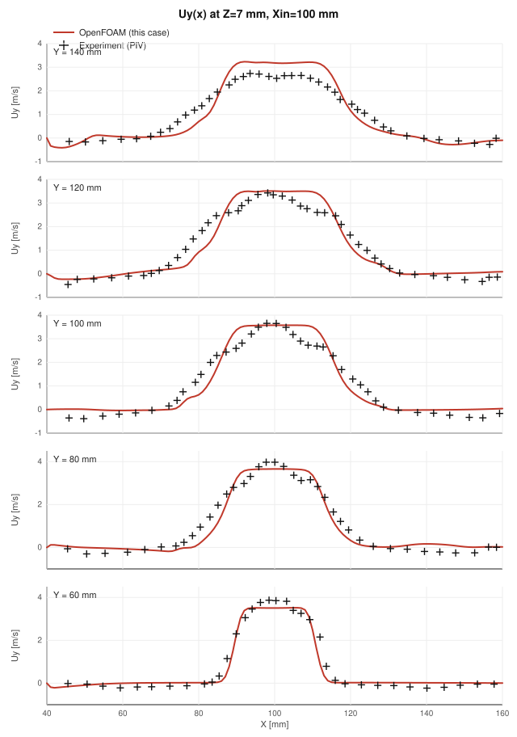
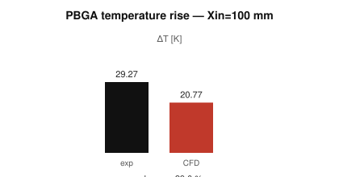

# CFD vs experiment — Xin = 100 mm

Reference: Hatakeyama et al., *J. Phys.: Conf. Ser.* **395** 012024 (2012).
PIV: streamwise velocity $U_y(x)$ at $Z=7$ mm. Thermal: PBGA temperature rise ΔT.

- Case: `Xin100`
- CFD time folder: `cached`
- Sample lines: $Y=60,80,100,120,140$ mm, $X=40$–$160$ mm, $Z=7$ mm
- PBGA ΔT = $T_\mathrm{heater} - T_\mathrm{inlet}$ = **20.77 K** (320.77 K − 300.00 K)

## Overlay

| | PNG | SVG |
|---|-----|-----|
| Streamwise $U_y$ (stacked) | [png](figures/fig6_Uy_validation.png) | [svg](figures/fig6_Uy_validation.svg) |

## Per-station SVG

| Station | SVG |
|---------|-----|
| Y = 60 mm | [svg](figures/fig6_Y60_validation.svg) |
| Y = 80 mm | [svg](figures/fig6_Y80_validation.svg) |
| Y = 100 mm | [svg](figures/fig6_Y100_validation.svg) |
| Y = 120 mm | [svg](figures/fig6_Y120_validation.svg) |
| Y = 140 mm | [svg](figures/fig6_Y140_validation.svg) |

## Error vs digitised PIV (CFD interpolated onto experiment $X$)

| Y [mm] | n | RMSE [m/s] | MAE [m/s] | max \|err\| [m/s] |
|--------|--:|-----------:|----------:|-------------------:|
| 60 | 35 | 0.311 | 0.214 | 1.247 |
| 80 | 38 | 0.357 | 0.295 | 0.799 |
| 100 | 40 | 0.422 | 0.346 | 0.821 |
| 120 | 44 | 0.417 | 0.325 | 0.905 |
| 140 | 42 | 0.435 | 0.369 | 0.787 |

## PBGA temperature rise vs experiment

Xin = 100 mm. Relative error is $(\mathrm{CFD}-\mathrm{exp})/\mathrm{exp}$.

| Quantity | Experiment | CFD | Error | Rel. error |
|----------|-----------:|----:|------:|-----------:|
| ΔT [K] | 29.27 | 20.77 | -8.50 | -29.0 % |

CFD ΔT is the volume-average temperature of region `PBGA` minus inlet $T$. Experiment ΔT is the measured PBGA package rise.

## Data files

- Experimental (digitised): `data/experiment/fig6_Y*.csv`
- Source scans: `../../../References/validation-benchmarks/Xin100-Y*.csv`
- CFD profiles: `data/cfd_fig6_Y*.csv`
- Metrics: `data/validation_metrics.csv`
- ΔT scalars: `data/fig7_scalars.csv`
- ΔT experiment: `data/experiment/fig7.csv`
- Rebuild SVGs only: `python3 Reports/scripts/make_validation_svgs.py`

## Notes

- PIV markers were digitised from the published streamwise-velocity plots; small digitisation scatter remains.
- Paper CFD was laminar SIMPLE (flow only). This case also solves Boussinesq energy (2.6 W PBGA).
